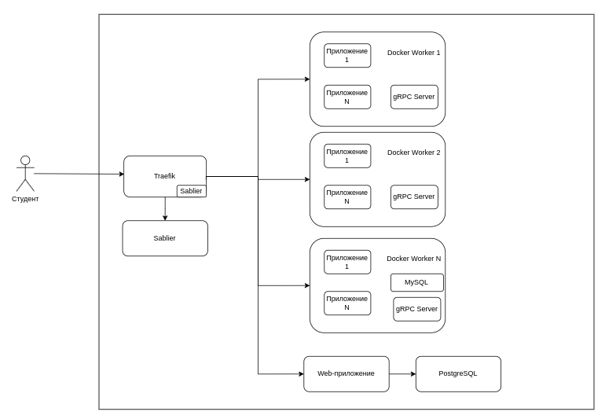

# Thesis - Serverless Hosting для студентов колледжа

Система serverless хостинга для образовательных учреждений, позволяющая студентам развертывать и тестировать веб-приложения в изолированной среде с автоматическим развертыванием и управлением ресурсами.

## 📋 Описание проекта

Данная система предназначена для создания современной образовательной инфраструктуры, которая позволяет студентам:

- Развертывать веб-приложения без настройки серверной инфраструктуры
- Работать в команде над совместными проектами
- Изучать современные технологии контейнеризации и микросервисов

### 🎯 Основные возможности

- **Масштабирование по требованию** с возможностью установки лимитов ресурсов
- **Мультитенантность** с изоляцией проектов между пользователями
- **Веб-интерфейс** для управления проектами и мониторинга
- **Образы на основе Docker Images** можно задеплоить дюбой проект
- **Система квот** для контроля использования ресурсов

## 🏗️ Архитектура системы



### Основные компоненты

- **FullStack**: Flet с FastAPI приложение для пользовательского интерфейса
- **API Gateway**: Traefik с настроенной маршрутизацией и балансировкой нагрузки
- **Agent**: Python gRPC
- **Container Runtime**: Docker для изоляции приложений
- **Orchestrator**: Docker Swarm для управления контейнерами
- **Database**: PostgreSQL для хранения метаданных

## 🚀 Быстрый старт

### Требования к системе

- **Операционная система**: Ubuntu 20.04+ или CentOS 8+
- **RAM**: минимум 8GB, рекомендуется 16GB+
- **CPU**: минимум 4 ядра, рекомендуется 8+
- **Дисковое пространство**: минимум 100GB SSD
- **Сеть**: статический IP-адрес в локальной сети

### Предварительная требования

1. **Установите git**
2. **Установите Docker**
3. **Установите расширение quota для Ubuntu и установите квоты для файловой системы**

### Установка хостинга

1. **Клонирование репозитория**:

```bash
git clone https://github.com/mainStorne/Thesis.git
cd Thesis
```

### 🔧 Конфигурация

#### Переменные окружения

Данные переменные окружения нужны чтобы создать базу данных postgresql для сервиса web, вам нужно будет продублировать эти настройки в сервисе **web** для корректного подлючения к базе данных

Создайте файл `.env` с необходимыми переменными:

```bash
# База данных
POSTGRES_DB=api
POSTGRES_USER=vFaWi722cKdlA8PeXuyAYoEYzEI
POSTGRES_PASSWORD=iXaoOngwIegUlYVkpU9wc1It1FU
POSTGRES_HOST=db
POSTGRES_PORT=5432
```

#### Сервис Web
По умолчанию создается аккаунт администратора, изменить пароль вы можете в конфигурации сервиса web.
При желании вы можете поменять домен всего хостинга, по умолчанию выставлен в thesis.com

```yaml
database: # Конфигуация базы данных postgresql продублируйте конфигурацию с .env файла
  db: api
  user: vFaWi722cKdlA8PeXuyAYoEYzEI
  password: iXaoOngwIegUlYVkpU9wc1It1FU
  host: db
  port: 5432

sublier: # Конфигурация serverless плагина Sublier
  session_duration: 2h # Через какое время после запуска приложения студента его выключить, удобно будет выставить через 2 часа как время проведения пары

domain: thesis.com # Домен для хостинга
mysql: # Кофигарация mysql, логин администратора - root
  password: vFaWi722cKdlA8PeXuyAYoEYzEI # Пароль для администратора mysql
admin: # Конфигцрация администратора хостинга, логин администратора - admin
  password: vFaWi722cKdlA8PeXuyAYoEYzEI # Пароль для администратора хостинга

jwt_secret: vFaWi722cKdlA8PeXuyAYoEYzEI # Секретный ключ для хеширования паролей
```

#### Сервис Agent
Agent всегда должен быть размещён на машине с включенной квотой.

```yaml
quota: # настройки квоты
  students_shared_base_dir: /students # директория для общих ресурсов, в этой директории размещёна база данных mysql
  students_home_base_dir: /home # домашняя директория студентов (пока что не используется)

```

2. **Выберите конфигурация для деплоя**:

Существует две конфигурации:

- Подходящая для [одного хоста](./docker-compose.prod.one-host.yaml)
- Подходящая для [нескольких](./docker-compose.prod.yaml)
В не зависимости какую конфигурацию выберите всегда можно увеличить количество хостов добавляя к swarm - docker worker node

3. **Запустите**

❗ В скрипте [create-registry.sh](./create-registry.sh) скачивается образ 8.0.42-debian для mysql, если вам нужен образ другой версии можете его заменить, главное чтобы api mysql было тем же самым, в частности чтобы работали mysql команды:
```sql
create user '<name>'@'%' identified by '<password>';
create database <db_name>;
grant all on <db_name>.* to '<name>'@'%';
```

```bash
sh create-registry.sh
docker compose -f ваш_yaml build
docker compose -f ваш_yaml push
docker stack deploy -c ваш_yaml thesis
```

## 💻 Использование

### Для студентов

1. **Регистрация в системе**:
   - Откройте веб-интерфейс по адресу `http://localhost`
   - Войдите в свой аккаунт по логину и паролю

2. **Развертывание приложения**:
   - В веб-интерфейсе нажмите "Создать проект"
   - Выберите zip архив
   - Выберите тип приложения
   - Нажмите "Загрузить"

### Для преподавателей
В разработке
1. **Просмотр проектов студентов**:
   - Создайте группу для своего курса
   - Добавьте студентов в группу
   - Администрируйте и просматривайте проекты студентов

### Дополнительные ресурсы
- [Пример репозитория с приложением php](https://github.com/mainStorne/Thesis-php-example), которое можно загрузить на хостинг.
- [Ролик с настройкой хостинга](https://disk.yandex.com/i/7OYHcTWAASErVg)
